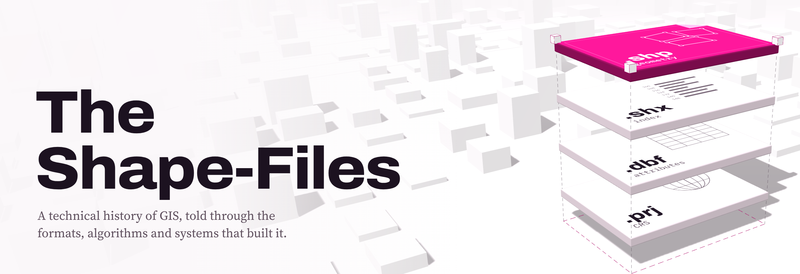

<picture>
  <source media="(prefers-color-scheme: dark)" srcset=".github/hero-dark.png">
  
</picture>

A technical history of GIS and geospatial computing by [Jacob Hogue](https://jacob-hogue.github.io). Each article starts with a real problem, shows how the technology answered it, and traces where that answer lives in the tools people use now. Every claim cites its source, and every result comes from code in this repository that you can run yourself.

**Read it at [jacob-hogue.github.io/the-shape-files](https://jacob-hogue.github.io/the-shape-files/).**

## Articles

| | Article | Code |
|---|---|---|
| A001 | [Before GIS Was Software: What Makes a Geographic Information System?](https://jacob-hogue.github.io/the-shape-files/articles/before-gis-was-software/) | [X001](lab/X001-three-representations) |

## Run the experiments

Each article's numbers come from a script in `lab/`. To rerun one:

```sh
cd lab/X001-three-representations
python3 -m venv .venv && . .venv/bin/activate
pip install -r requirements.txt
python3 run.py
```

The data is synthetic and the seed is fixed, so you should get the same numbers as the article.

## Build the site

The site is built with [Quarto](https://quarto.org) 1.11:

```sh
quarto preview
```
