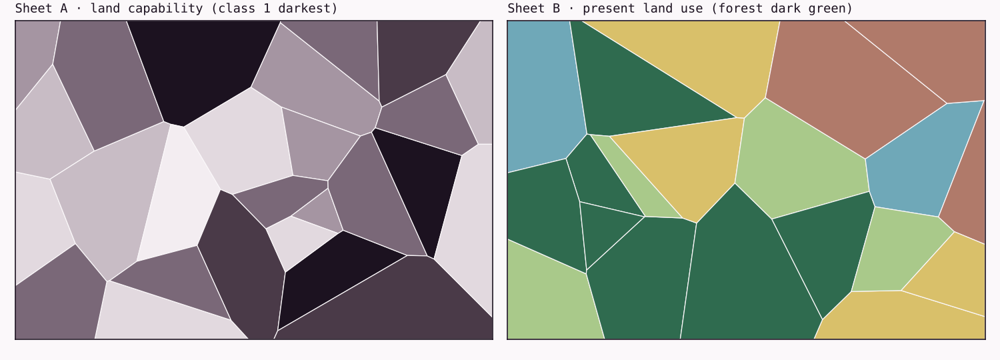

::: {.sf-hero-mount data-height="320" data-seed="1967" data-shift="0.2" data-title="Banner: a map image, a coordinate table and a queryable store floating above a city grid; the queryable store is highlighted" data-layers='[{"ext":"gpkg","role":"queryable store","motif":"polygons","subject":true},{"ext":"csv","role":"coordinates","motif":"table"},{"ext":"png","role":"map image","motif":"raster"}]'}
:::

```{=html}
<div class="sf-article-path">
```

```{=html}
</div>
```

In 1967, the Canada Land Inventory put in writing a problem most map agencies only complained about. It had more mapped information than its staff could use. A report describing its new "geo-information system" said that a lack of trained people made it impossible to examine the inventory's data manually "in any sensible time," and that "a situation is reached where the amount of data precludes their use" [@tomlinson1967].

That's a strange thing for a mapping program to admit. The maps existed. They were accurate enough for the job. What the inventory couldn't do was ask them questions fast enough. How much land rated good for agriculture is currently under forest, county by county? Answering that meant laying a capability map over a land-use map, finding where the two agreed, and measuring the areas, then doing it again for the next county and the next question.

Accounts of how big the job was differ. Roger Tomlinson, the inventory's data processing coordinator, later recalled about 1,500 maps planned at 1:50,000 and 1:250,000 [@tomlinson2012]. The 1967 report talks about up to 30,000 map sheets, which probably counts something different, such as working sheets across every theme. Either way, the answer was the same: build a system that kept the maps as data and did the overlay and measurement itself.

That system, the Canada Geographic Information System (CGIS), usually gets the credit as the first GIS. Whether it deserves the title depends on what you think a GIS is, which is the real subject of this article.

## The word came before anyone agreed on it

The phrase "geographic information system" shows up earlier than the story usually allows. A December 1965 report from Northwestern University by the geographers Michael Dacey and Duane Marble has "geographic information systems" in its title. According to later descriptions, it uses the phrase without explaining where it came from, as if its readers already knew it, and its distribution list included Tomlinson [@geographyrealm; @hessler2015]. We haven't seen the report itself, and the two descriptions don't even agree on the exact wording of its title.

The 1967 Canada Land Inventory report is more interesting than its reputation. Its title says "Geo-Information System," but the body uses "geographic information system" again and again: "Such a system is the geographic information system of the Canada Land Inventory" [@tomlinson1967]. Then came Tomlinson's 1968 paper "A Geographic Information System for Regional Planning," in a symposium volume published in Australia [@tomlinson1968]. Esri's history of the project and the IEEE plaque in Ottawa both treat the 1968 paper as the first published use of the term [@esri2012; @ieee2023]. On Tomlinson's own record, that seems to be a year late.

```{=html}
<figure class="sf-fig sf-fig-plain" aria-labelledby="fig-timeline-cap">
<div class="sf-fig-head"><span class="sf-fig-num">Fig. 1</span><span class="sf-fig-title">Early appearances of the phrase</span></div>
```

```{=html}
<figcaption class="sf-fig-cap" id="fig-timeline-cap"><span class="sf-fig-captext">The 1967 report is the earliest use examined so far. Each marker shows how solid the evidence is: a full square means examined, half means examined by automated extraction and not yet checked by hand, a center dot means known from a secondary source, and an empty square means located but not read.</span></figcaption>
</figure>
```

Nobody seems to know who said it first, and the people involved weren't working alone. Nicholas Chrisman, writing a history of the field's academic side, describes a 1963 workshop in Chicago, run by Edgar Horwood of the University of Washington, that brought together Tomlinson, Marble, the transportation geographer William Garrison and Howard Fisher, who would found the Harvard Laboratory for Computer Graphics two years later. "Information system," Chrisman notes, was "in the air" [@chrisman2020].

Agreeing on the word didn't produce agreement on the thing. By 1991, when David Maguire surveyed the definitions in circulation, he found three common views of what a GIS was: a map-processing system, a database, or a tool for spatial analysis. He also found that the term could mean a technology, a working system in an organization, or a discipline [@maguire1991]. David Cowen had drawn a sharper line in 1988. In his often-quoted example, a computer-aided design (CAD) system could draw a city's parcels but couldn't shade each one from the assessor's database [@cowen1988; @dibiase_nature]. The example marks the gap between drawing geography and analyzing it.

Those definitions disagree because they come from people who needed different things. A cartographer, a database administrator and a planner each saw a different part of the same machine. The disagreement is useful, because it tells you what the parts are.

## What makes information geographic

Strip away the software and a piece of geographic information is small. It's a location tied to something about that location. Michael Goodchild's encyclopedia definition says it links locations near the Earth's surface to the properties found there [@goodchild2010]. A soil class at a point. A land-use code for a parcel. A temperature in a grid cell at noon on a given day, because time is usually part of it too.

There are two ways to think about what you're recording, and they shape everything that follows. You can treat the world as continuous fields, where every location has a value (elevation, temperature, soil moisture). Or you can treat it as discrete objects with boundaries (a parcel, a well, a road). Neither is the truth. They're choices about how to describe a place, and later data models encode them: rasters usually hold fields, and vectors usually hold objects. Volume 1 comes back to both, in *Points, Lines, Polygons* (A008) and *Grids and Cells* (A009).

None of this needs a computer. A surveyor's field book is geographic information. So is every printed map.

## Maps already did analysis, slowly

It's easy to tell this history as if analysis arrived with software. It didn't. Thematic maps were analytical instruments for well over a century before CGIS. Charles Dupin's 1826 map of France, which shaded each département by a statistic, is usually counted as the first choropleth [@korycka2017]. By the middle of the twentieth century, planners stacked transparent sheets of soils, slopes and drainage on a light table to see where they lined up. Ian McHarg's *Design with Nature* (1969) is the best-known statement of the method [@mcharg1969].

Measurement was manual too. Areas came from planimeters or dot grids laid over the sheet, and from patient people counting.

What those methods had in common was where the analysis lived: in the procedure and in the people, not in the map. A finished map recorded the answer to one question at one scale. Ask a different question and you started again from the source sheets. That's the cost the Canada Land Inventory was describing in 1967.

## Storing geography versus computing with it

The 1967 report's description of its system is plain and, read today, surprisingly modern. It says the system has two parts: the "data bank," and what it calls the "information system," meaning the set of procedures for moving data into the bank and manipulating it once it's there. It claims the system "can measure any data in the data bank," and it describes overlay by analogy with laying two maps over each other [@tomlinson1967].

One line in it would fit in a software architecture document: "The system is independent of peripheral devices such as input scanners or output plotters." The data and the operations were the point. The scanner that read the maps and the plotter that drew the results were interchangeable parts around them.

Waldo Tobler had already drawn this kind of distinction in 1959. As the Leventhal Map & Education Center's recent exhibition summarizes his "Automation and Cartography," he saw three openings for computers: the map as data storage, the map as input, and the map as output [@leventhal2024; @tobler1959]. Much of the early computer cartography, including Harvard's SYMAP, aimed at the third: getting maps out of computers. A GIS is built around the first two: a store that persists, and procedures that can run against it again tomorrow with a different question.

So the working definition this publication uses is a functional one. A geographic information system is a combination of data, procedures, software, hardware and people that holds geographic information in structured form, so that it can be retrieved, combined, measured and analyzed repeatedly, and the results reported. It's this publication's definition, not a quotation, and the rest of the series tests it.

## One question, three ways

To make the difference concrete, we built a small synthetic area and asked it the Canada Land Inventory's kind of question: how much class 1–2 land is currently forested? The area is 12 by 8 km on a local grid in meters, with  land-capability parcels and  land-use parcels. It's invented, so nothing here describes a real place. Then we stored the same two layers three ways.

```{=html}
<figure class="sf-fig" aria-labelledby="fig-sheets-cap">
<div class="sf-fig-head"><span class="sf-fig-num">Fig. 2</span><span class="sf-fig-title">Two map sheets, one area</span></div>
<div class="sf-fig-frame"><span class="sf-fig-corner sf-fig-tl" aria-hidden="true"></span><span class="sf-fig-corner sf-fig-tr" aria-hidden="true"></span><span class="sf-fig-corner sf-fig-bl" aria-hidden="true"></span><span class="sf-fig-corner sf-fig-br" aria-hidden="true"></span><div class="sf-fig-body">

</div></div>
<figcaption class="sf-fig-cap" id="fig-sheets-cap"><span class="sf-fig-captext">Each sheet answers its own question. Neither answers the overlap, which is the question the inventory needed.</span><span class="sf-fig-meta">Synthetic data, local grid in meters · no real location</span></figcaption>
</figure>
```

### As printed map sheets

If all you have is the two images, you can still get an answer the way a technician with a light table would. Line the sheets up, find the places where the dark capability classes coincide with forest green, and count. We did that by reading the image pixels. At 60 m cells the count comes to  ha, % below the true figure. At 12 m cells it's  ha, off by %. Both numbers depend on something the images don't contain: we had to tell the code that the sheets were 12 km wide. A map image doesn't know its own scale.

### As coordinate and attribute tables

Put the parcels in CSV files, one row per vertex plus an attribute table, and the data is finally exact:  vertex rows in all. The surveyor's formula (the shoelace formula, a few lines of arithmetic over the vertices) gives exact areas for every parcel. So the tables can tell you there are  ha of class 1–2 land and  ha of forest. They can't tell you how much is both, because that needs the two sets of polygons intersected, and no table operation does that. Tables store geography. They don't compute with it.

### As a queryable store

Put the same layers in a GeoPackage and the question becomes one query:

```sql
SELECT round(sum(ST_Area(ST_Intersection(c.geom, u.geom))) / 10000, 1) AS hectares
FROM ST_Read('data/x001.gpkg', layer = 'capability') AS c
JOIN ST_Read('data/x001.gpkg', layer = 'land_use') AS u
  ON ST_Intersects(c.geom, u.geom)
WHERE c.class IN (1, 2) AND u.use = 'forest';
```

DuckDB's spatial extension returns  ha, and an independent overlay in GeoPandas agrees to the decimal ( ha). Change the classes or the land use and you have a new answer in the time it takes to edit one line. That's the 1967 design in miniature: a data bank, and procedures that run against it.

::: {.sf-callout .sf-callout-executed}
::: {.sf-callout-head}
[Executed]{.sf-callout-kind} [ · ]{.sf-callout-meta}
:::
Every number in this section comes from one run of `lab/X001-three-representations/run.py`, recorded in its `results.json`. The data, both scripts and the GeoPackage are in that folder.
:::

```{=html}
<figure class="sf-fig" aria-labelledby="fig-answer-cap">
<div class="sf-fig-head"><span class="sf-fig-num">Fig. 3</span><span class="sf-fig-title">The answer, drawn</span></div>
<div class="sf-fig-frame"><span class="sf-fig-corner sf-fig-tl" aria-hidden="true"></span><span class="sf-fig-corner sf-fig-tr" aria-hidden="true"></span><span class="sf-fig-corner sf-fig-bl" aria-hidden="true"></span><span class="sf-fig-corner sf-fig-br" aria-hidden="true"></span><div class="sf-fig-body">
```

```{=html}
</div></div>
<figcaption class="sf-fig-cap" id="fig-answer-cap">
```

```{=html}
<span class="sf-fig-captext">The 1,079.3 ha that are both class 1–2 and forested. None of these shapes exists on either source map; the store produced them on demand.</span>
<span class="sf-fig-meta">Synthetic data, local grid in meters · no real location</span>
</figcaption>
</figure>
```

The point isn't that the printed sheets were inaccurate. At fine resolution they got within half a percent. The point is what each form lets you do next. The sheets answer one question per tedious session. The tables are exact but inert. Only the store lets you ask, and ask again.

## The parts of a GIS

Textbooks list the parts of a GIS in slightly different ways, but they settle on data, software, hardware, procedures and the people who run it. Longley and his co-authors make a point of counting the people as part of the system rather than its users [@longley1999].

The 1967 report maps onto that list without much strain. The data is the bank of digitized boundaries and codes. The procedures are input, retrieval, overlay and measurement. The hardware is spelled out: an IBM System/360 Model 50, magnetic tape, and a drum scanner that took about 15 minutes to read a full map sheet [@tomlinson1967]. The people show up in the report's opening complaint, which was really about having too few of them. What has changed since is mostly the hardware and the software. The list hasn't.

## Why the 1960s, and why more than one place

Three things arrived together. The first was cost: by 1960, Tomlinson later recalled, manual map analysis at Spartan Air Services, the Ottawa survey firm where he worked, was "almost as costly as the surveys themselves" [@tomlinson2012]. The second was method. Geography's quantitative turn, centered on groups like Garrison's at the University of Washington, where Marble earned his doctorate in 1959, was producing people who expected to compute with spatial data [@chrisman2020]. The third was machines that a government agency or a university could get time on.

The same pressures produced systems in several places at once. In the US, Census Bureau staff working on a 1967 test of procedures for the 1970 census in New Haven, Connecticut, worked out a way to encode streets, intersections and blocks that became the DIME files, and later a component of the TIGER files built for the 1990 census [@census_dime]. Fisher founded the Harvard laboratory in 1965 with Ford Foundation money, and by 1970 its SYMAP mapping program was in use at more than 500 institutions. In Britain, the Experimental Cartography Unit started at the Royal College of Art in 1966 or 1967 [@chrisman2020].

So the IEEE plaque in Ottawa calls CGIS the first GIS [@ieee2023], and Goodchild calls Tomlinson the "leading candidate" for the title of father of GIS. In the same chapter, Goodchild counts "at least five distinct and independent threads," and points out that CGIS was built for "one and only one task, the production of area statistics" [@goodchild2010]. Both readings can stand. A fair one is that CGIS was the first large system built and described in these terms, and one of several efforts converging on the same idea from different directions. Goodchild returned to the subject in a 2018 paper, "Reimagining the History of GIS" [@goodchild2018].

## Where it shows up today

The small unit at the bottom of all this, a location tied to a property, is what a row in a GeoParquet file or a PostGIS table still holds. The 1967 split between a data bank and the procedures that run against it is the split between storage formats and query engines. In our test, a GeoPackage file and DuckDB, two pieces of software that know nothing about each other, did together what CGIS needed a mainframe and a custom scanner to do. The idea held up. The parts got cheaper.

If a GIS stores locations, the next question is what a location actually is. That depends on how people measured the Earth, long before anyone digitized it, and it's where the next article, *How Humans Learned to Measure the Earth* (A002), begins.

## Notes on sources

This is a draft. Several claims rest on sources we have read only through automated text extraction, including the 1967 report, which survives online as a poor scan. Every quotation from it will be checked by hand against a clean copy before publication. We have not seen two documents this article discusses: the 1965 Dacey and Marble report and Tomlinson's 1968 paper. What it says about them comes from the later descriptions cited. If you have access to either, the project's research notes list what we need to confirm.

## References {.unnumbered}

::: {#refs}
:::
